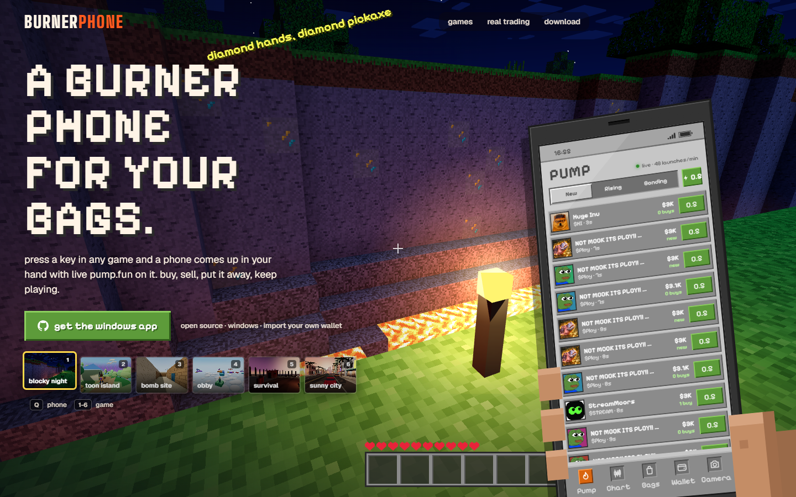

# BurnerPhone

A burner phone for your bags. Press **Alt+Q** in any game and a phone comes up in your hand with live pump.fun on it: launches seconds after they happen, your bags ticking, one tap to buy or sell. Press it again and the clicks go straight back to the game.



- **Website (paper trading demo):** https://burner-production-5f82.up.railway.app
- **Windows app:** grab the zip from [Releases](../../releases/latest), unzip, run `BurnerPhone.exe`.

## What it does

- **Sits on top, never touches the game.** BurnerPhone is a transparent, click-through window over your screen, the same way stream overlays work. No mods, no injection, no reading game memory. Run the game borderless windowed (exclusive fullscreen hides every overlay). Change the hotkey from the tray icon; on more than one monitor the phone comes up on the screen your mouse is on.
- **A phone that belongs in each game.** BurnerPhone checks which game is in front and swaps the phone: a pixel phone for block worlds, a chunky toon phone for battle-royale islands, a green-screen PDA for tactical shooters, a toy phone for block-party games, a battered walkie-phone for survival islands, a glass phone for crime cities, graphite for everything else. All our own art.
- **Live pump.fun.** New launches, rising coins, coins close to bonding, real candles and trades for the coin you open, rug and bond stamps as they happen.
- **WASTED / MISSION PASSED.** When a bag you hold rugs, the phone rings and the screen goes grey. Sell for 2x+ and it rolls in gold.
- **Camera.** Shoots the game behind the phone and stamps your trade on it.

## Paper or real

You start on 10 paper SOL with the bonding curve's real slippage and fees.

When you want it real, open **Wallet → import wallet** (or **new burner**) in the app:

- The private key is encrypted with Windows (Electron `safeStorage` / DPAPI) and stored only on your PC. It lives in the app's main process; the phone UI never sees it. No server of ours ever receives it.
- Every transaction is **simulated before it is signed**. The app refuses it if the wallet would lose more SOL than you asked for (plus slippage and ≤ 0.01 SOL of fees), if any other token would leave the wallet, or if the simulation can't run.
- Trades go from your PC straight to Jupiter (Ultra API) or, for coins only seconds old, PumpPortal's local transaction API (0.5% PumpPortal fee), and the Solana network.
- Use a burner wallet with only what you'd spend in the trenches. Memecoins go to zero all the time.

The website is paper trading only and never asks for a key.

## Build from source

```bash
npm install
npm run build          # the website + phone
npm start              # api + site on :8787 (or PORT)

cd desktop
npm install
BURNER_API=https://burner-production-5f82.up.railway.app npm run dist   # → desktop/dist/burnerphone-windows.zip
```

The Windows build isn't code-signed yet, so SmartScreen asks once (More info → Run anyway), or build it yourself from this source.

## Layout

```
shared/phone/     the phone (DOM + CSS 3D): apps, skins, motion, paper + real wallet adapters
shared/WALLET.md  the real-wallet contract and its safety rules
server/           one Node service: pump.fun launch stream, prices, candles, the site
web/              the site and its three.js game worlds
desktop/          the Electron overlay: window, hotkey, game detection, encrypted key, signer + guard
```

Live data from pump.fun, PumpPortal, Jupiter, GeckoTerminal and DEX Screener. Not affiliated with any game.

MIT license.
