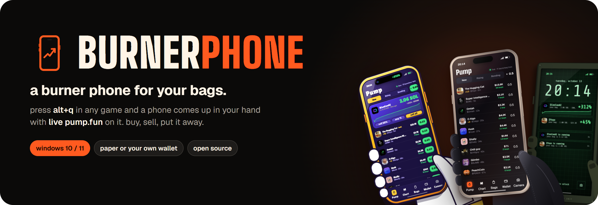
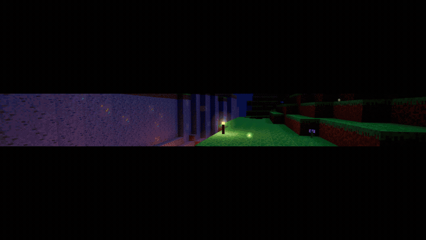
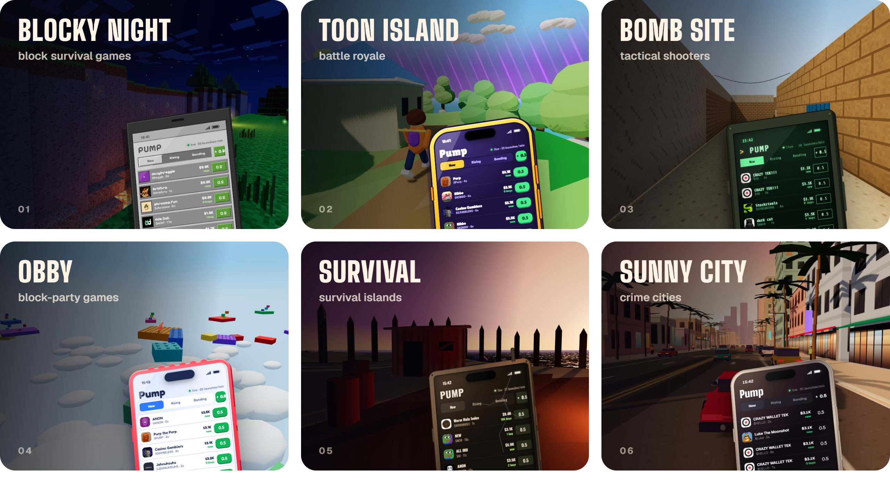
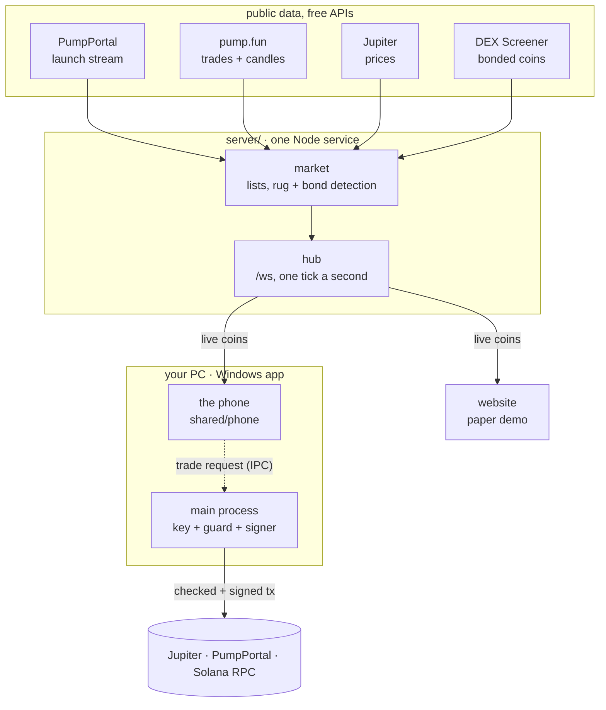
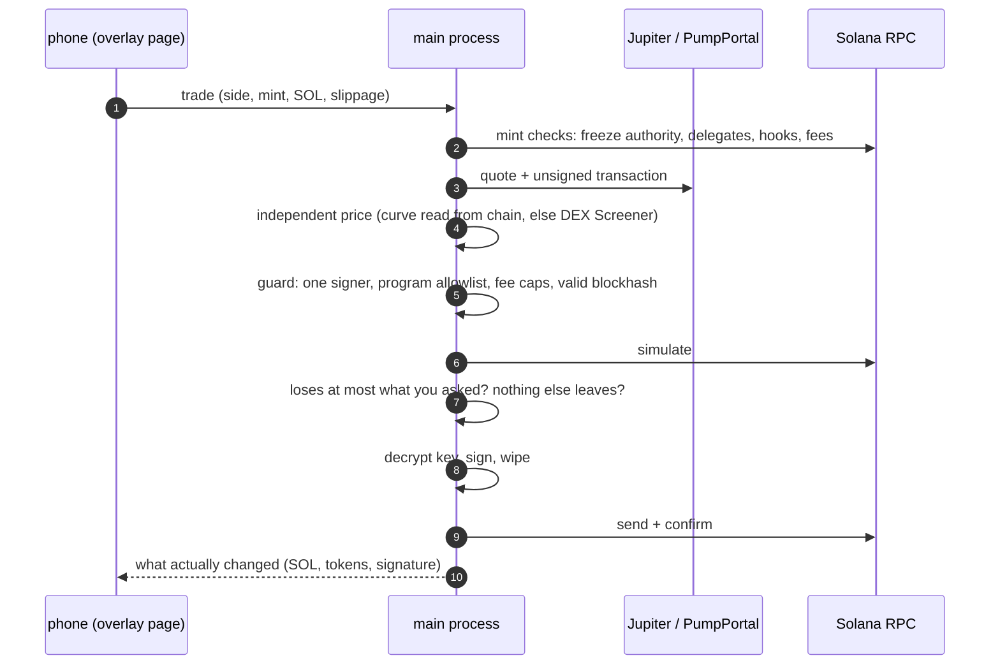

<div align="center">

<a href="https://burnerphone.fun"></a>

<p>
  <a href="https://github.com/burnerphonefun/Burner-Phone/releases/latest"></a>
  <a href="https://github.com/burnerphonefun/Burner-Phone/releases"></a>
  <a href="https://github.com/burnerphonefun/Burner-Phone/actions/workflows/ci.yml"></a>
  
  <a href="LICENSE"></a>
  <a href="https://x.com/burnerphonefun"></a>
</p>

<h3>
  <a href="https://github.com/burnerphonefun/Burner-Phone/releases/latest">Download for Windows</a>
  &nbsp;·&nbsp;
  <a href="https://burnerphone.fun">Try it in the browser</a>
  &nbsp;·&nbsp;
  <a href="#how-it-works">How it works</a>
  &nbsp;·&nbsp;
  <a href="https://x.com/burnerphonefun">X / Twitter</a>
</h3>

<br>



<sub>one phone, every game · <a href="https://burnerphone.fun/media/teaser-games.mp4">watch the teaser with sound ↗</a></sub>

</div>

<br>

You're mid-game and a coin you hold starts moving. BurnerPhone puts a phone in your character's hand with live pump.fun on it: launches seconds after they happen, your bags ticking, one tap to buy or sell (or type any amount on its keypad). Press **Alt+Q** again and the clicks go straight back to the game.

<table>
<tr>
<td width="33%" valign="top">

**Sits on top, never inside**<br>
A transparent, click-through window over your screen, the same way stream overlays work. No mods, no injection, no reading game memory.

</td>
<td width="33%" valign="top">

**Live pump.fun**<br>
New launches, rising coins, coins close to bonding, real candles and trades for the coin you open, rug and bond stamps as they happen.

</td>
<td width="33%" valign="top">

**Paper or your own wallet**<br>
Start on 10 paper SOL with the curve's real slippage and fees. Import a burner wallet when you want it real. The key never leaves your PC.

</td>
</tr>
</table>

## One phone for every game

BurnerPhone checks which game is in front and hands you the phone that belongs there. All our own art: no game's names, logos or assets.



## Rugs ring. Wins roll in gold.


When a bag you hold actually rugs (down and still falling, not just a dip), the phone rings with a **rug call**, the world goes grey and **WASTED** drops in. Hit **sell** to get out with what's left, or **hold** and pray.

Sell for 2x or more and **MISSION PASSED** rolls in with the SOL you made.

The **camera** app shoots the game behind the phone and stamps your trade on it, in the game's own style, ready to post.

<br clear="right">

## Get it

1. Download **`BurnerPhone-Setup.exe`** from the [latest release](https://github.com/burnerphonefun/Burner-Phone/releases/latest) and run it. It installs just for you (no admin), adds a Start menu shortcut and sits in the tray. No installer wanted? The portable `burnerphone-windows.zip` is right next to it.
2. Press **Alt+Q** in any game.

> [!TIP]
> Run your game in **borderless windowed**. Exclusive fullscreen hides every overlay, this one included. Change the hotkey from the tray icon; with more than one monitor the phone comes up on the screen your mouse is on.

**Built by GitHub, checkable by anyone.** Every release is built by the [release workflow](.github/workflows/release.yml) on a GitHub runner from the tagged commit (nobody's PC is in the loop), and GitHub signs a build provenance certificate for the downloads:

```bash
gh attestation verify BurnerPhone-Setup.exe --repo burnerphonefun/Burner-Phone
```

The app isn't code-signed yet (a paid certificate), so SmartScreen says "unknown publisher" once: **More info → Run anyway**. Or [build it yourself](#build-from-source).

## Paper or real

You start on **10 paper SOL**. Fills follow the bonding curve with its real slippage and fees, so a paper 3x is a real 3x.

When you want it real, open **Wallet → import wallet** (or **new burner**) in the app:

- The private key is encrypted with Windows (Electron `safeStorage` / DPAPI) and stored only on your PC. It lives in the app's main process; the phone UI never sees it. Typing it in and revealing it happen in a separate local window that loads nothing remote and is hidden from screen capture.
- Every transaction is **simulated before it is signed**. The app refuses it if the wallet would lose more SOL than you asked for (plus slippage and ≤ 0.01 SOL of fees), if any other token would leave the wallet, or if the simulation can't run.
- Trades go from your PC straight to Jupiter (Ultra API) or, for coins only seconds old, PumpPortal's local transaction API (0.5% PumpPortal fee), and the Solana network. Never through our server.

> [!WARNING]
> Use a burner wallet with only what you'd spend in the trenches. Memecoins go to zero all the time.

The website is paper trading only and never asks for a key.

## How it works



One server holds every upstream connection and pushes the market to every phone (the site and the Windows app), so a thousand phones cost the APIs the same as one. Real trades skip the server entirely: they go from your PC to the chain.

<details>
<summary><b>What happens when you tap buy with a real wallet</b></summary>
<br>



Any failed check stops the trade before anything is signed. The full contract is in [`shared/WALLET.md`](shared/WALLET.md) and the guard is [`desktop/solana.cjs`](desktop/solana.cjs).

</details>

<details>
<summary><b>How a rug is called</b></summary>
<br>

The server watches every coin any phone can see and calls a rug when the price falls 70% from its 5-minute high after a real pump, when the dev sells 80%+ of their bag and the price drops 40%, or when a bonded coin's liquidity falls under 20% of its peak. The phone only rings **WASTED** if you hold the coin, you're actually down (under 0.6x) and the fall held for two price points. A dump while you're still up is a notification, not a funeral.

</details>

<details>
<summary><b>How the overlay knows which game you're in</b></summary>
<br>

A tiny Rust helper ([`desktop/detect`](desktop/detect/src/main.rs), no dependencies, ~250 KB) asks Windows which window is in front, what it's called and which program owns it, and prints one line every two seconds. The main process maps it to a phone skin. That's all it reads: no game files, no memory, no input hooks beyond the hotkey. It exits by itself when the app closes.

If the helper is missing or keeps failing, a PowerShell script with a few lines of C# ([`detect.ps1`](desktop/detect.ps1) + [`detect.cs`](desktop/detect.cs)) does the same job.

</details>

More: [`docs/ARCHITECTURE.md`](docs/ARCHITECTURE.md) · the data contract [`shared/PROTOCOL.md`](shared/PROTOCOL.md) · the wallet contract [`shared/WALLET.md`](shared/WALLET.md)

## Build from source

Needs Node 24. For the Windows app, [Rust](https://rustup.rs) too (the game detector; without it the app falls back to PowerShell).

```bash
npm install
npm run build          # the website + phone
npm start              # api + site on :8787 (PORT to change)

cd desktop
npm install
BURNER_API=https://burnerphone.fun npm run dist   # → desktop/dist: BurnerPhone-Setup.exe, the portable zip, SHA256SUMS.txt
```

Tests:

```bash
node scripts/wallet-test.mjs                                # paper fills, the curve, rug watch
node scripts/wallet-real-test.mjs --offline --no-electron   # the real-wallet guard against crafted transactions, key handling
cd desktop/detect && cargo test                             # the detector's parsing (Rust)
node scripts/detect-test.mjs                                # the app's detector code against the helper and the fallback (Windows)
```

<details>
<summary><b>Project layout</b></summary>
<br>

```
shared/phone/     the phone (DOM + CSS 3D): apps, skins, motion, paper + real wallet adapters
shared/curve.js   pump.fun bonding-curve maths, used by the server and the phone
server/           one Node service: launch stream, prices, candles, rug detection, the site
web/              the site and its three.js game worlds (shaders in web/src/scene/shaders, GLSL)
desktop/          the Electron overlay: window, hotkey, encrypted key, signer + guard
desktop/detect/   the game detector (Rust), with a PowerShell + C# fallback next to it
scripts/          tests, screenshot and teaser tools, this README's art (readme-art.mjs)
Dockerfile        the server's image (site + api); fly.toml runs it on Fly.io
```

</details>

## FAQ

<details>
<summary><b>Can this get me banned?</b></summary>
<br>
It doesn't touch any game: no injection, no mods, no reading memory, no automation. It's a transparent window on top, the same way stream overlays and voice-chat overlays work.
</details>

<details>
<summary><b>Is my wallet safe?</b></summary>
<br>
The key is encrypted on your PC and only ever used there, by the app's main process, for the moment it signs. Every transaction is simulated and checked first. Read <a href="SECURITY.md">SECURITY.md</a> and the guard in <a href="desktop/solana.cjs"><code>desktop/solana.cjs</code></a>. Still: use a burner wallet with small amounts.
</details>

<details>
<summary><b>Mac or Linux?</b></summary>
<br>
Windows only for now: the overlay relies on Windows for the click-through window, game detection and key encryption. The <a href="https://burnerphone.fun">website</a> works everywhere, phones included.
</details>

<details>
<summary><b>Does it cost anything?</b></summary>
<br>
No. Paper trading is free. Real trades pay the normal network fee, and PumpPortal takes 0.5% on the few trades routed through it (coins only seconds old that Jupiter can't route yet).
</details>

## Contributing

Bug reports, ideas and pull requests are welcome. Start with [CONTRIBUTING.md](CONTRIBUTING.md). Found a way around the wallet guard? Please report it privately: [SECURITY.md](SECURITY.md).

<br>

<div align="center">
<sub>Live data from pump.fun, PumpPortal, Jupiter, GeckoTerminal and DEX Screener. Not affiliated with any game or with pump.fun. MIT license.</sub>
</div>
