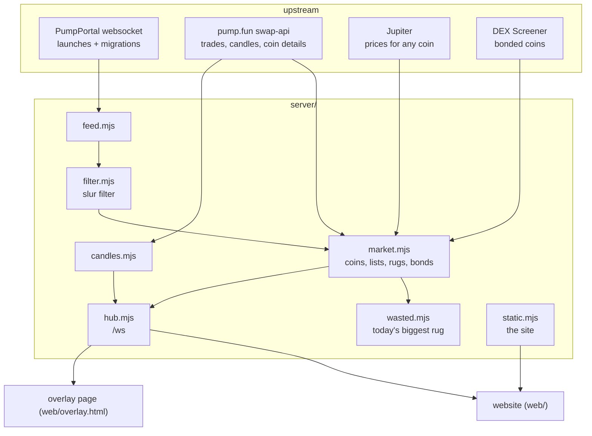
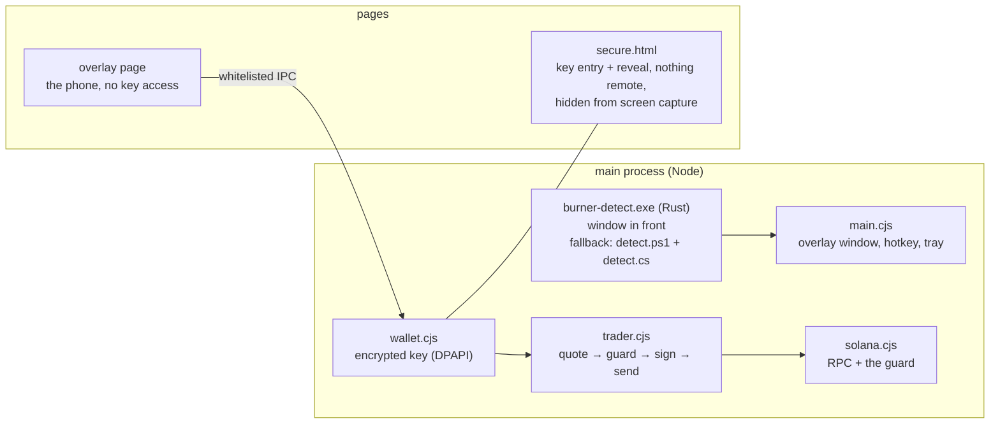

# How BurnerPhone is built

Three parts share one phone:

| part | where | what it does |
| --- | --- | --- |
| **the phone** | `shared/phone/` | the phone itself: a DOM + CSS 3D rig (hand, phone, springs), its apps, skins and banners. Used by the website and the Windows app. |
| **the server** | `server/` | one Node service: every upstream connection, the market, rug and bond detection, `/ws` to every phone, the website's files. |
| **the Windows app** | `desktop/` | an Electron overlay: a transparent click-through window, the hotkey, game detection, and the real wallet (key, guard, signer). |

## The server

- **One set of upstream connections for every phone.** A thousand open phones cost pump.fun, Jupiter and PumpPortal the same as one. Phones never call those APIs themselves.
- **Lists:** `new` (seconds-old launches), `rising` and `bonding` (closest to graduating), recomputed from live numbers.
- **Push, not poll:** on connect a phone gets a `hello` with everything it needs, then one `tick` a second with only the coins whose numbers moved, plus `new`, `rug`, `grad` and `trades` events. The contract is [`shared/PROTOCOL.md`](../shared/PROTOCOL.md).
- **Degrades instead of dying:** if pump.fun's API refuses a datacenter IP the market falls back to Jupiter prices; if the socket drops, phones poll `/api/snapshot`; if everything is down, phones keep the last state they had. Unknown numbers stay `null` and show as `–`, never as 0.
- **Rug calls:** a 70% fall from the 5-minute high after a real pump, a dev selling 80%+ of their bag into a 40% drop, or a bonded coin's liquidity under 20% of its peak.
- **Names are cleaned** before they reach any phone: invisible filler characters stripped, launches with slurs in the name or ticker dropped.

## The phone

- **DOM, not WebGL.** Crisp text, real clicks, native scrolling. The 3D tilt and the hand are CSS transforms.
- **One motion loop that sleeps.** Springs and number tickers share a single `requestAnimationFrame` loop (`motion.js`) that stops when nothing moves. Only `transform` and `opacity` animate, because the overlay shares the GPU with your game.
- **Apps are modules built once and patched:** `pump`, `chart`, `bags`, `wallet`, `camera` under `apps/`. A tick updates text and transforms in place; nothing re-renders a list.
- **Two wallets, one interface.** `wallet.js` (paper: fills on the curve with slippage and fees) and `wallet-real.js` (talks to the main process) expose the same `buy` / `sell` / `bags` / `worth` API, so every app works with either.
- **Skins** (`skins.css`, `hands.js`) restyle the same phone per world: pixel, toon, PDA, toy, walkie, glass.

## The Windows app

- **Overlay:** a frameless, transparent, always-on-top window over the display your mouse is on. It ignores the mouse until the phone is up, so clicks fall through to the game.
- **Game detection:** `bin/burner-detect.exe`, built from [`desktop/detect`](../desktop/detect/src/main.rs) (Rust, no dependencies, four Windows calls declared by hand), prints the foreground window's process name and title every 2 seconds and exits on its own when the app closes its pipe. The main process maps the name to a skin, ignoring its own windows (the raised phone and the wallet window take focus). If the helper is missing or dies twice without a line, `detect.ps1` takes over: one long-lived PowerShell process that compiles [`detect.cs`](../desktop/detect.cs) and prints the same lines. Nothing else about the game is read.
- **The key** is encrypted at rest with Electron `safeStorage` (Windows DPAPI), decrypted only for the moment it signs, then wiped. The overlay page can't read it: import, reveal and confirmations happen in `secure.html`.
- **The guard** (`solana.cjs`), before every signature, fails closed at each step: exactly one signer, a per-route program allowlist, no durable nonces, a valid blockhash, priority fee ≤ 0.002 SOL, mint checks before buys (freeze authority, permanent delegate, transfer hook, non-transferable, default-frozen, transfer fee > 10%), a minimum received from the stricter of the route's quote and an independent price, and a simulation showing the wallet loses at most what you asked for and nothing else leaves it. Full contract: [`shared/WALLET.md`](../shared/WALLET.md).
- **Hardening:** Electron fuses (`runAsNode` off, asar-only, asar integrity), a strict CSP baked into the overlay page, permission handlers, devtools only in dev builds.

## The website

`web/` is the same phone over six three.js worlds (`web/src/scene/`), one per phone skin. Skies, the storm wall and the grey WASTED pass are GLSL shaders in [`web/src/scene/shaders/`](../web/src/scene/shaders), imported as text. Each world has its own fake HUD driven by your paper wallet, and reacts to the market: a red hit when a coin in the list rugs, a gold sweep when one bonds. On phones the visitor's own screen is the burner.

## Tests

- `node scripts/wallet-test.mjs`: curve maths, paper fills, rug watch.
- `node scripts/wallet-real-test.mjs --offline --no-electron`: the guard against crafted account states and transactions, key import/export round trips, static checks of the shipped files. Without `--offline` it also simulates real routes against mainnet (nothing is signed or sent).
- `cargo fmt --check`, `cargo clippy -- -D warnings` and `cargo test` in `desktop/detect`: the detector's name and line handling.
- `node scripts/detect-test.mjs` (Windows): `main.cjs`'s own detector code, lifted out and run without Electron, against the Rust helper, the PowerShell + C# fallback, and a helper that dies silently.

All of them run in CI on every push (the detector on a Windows runner, which also uploads the built `burner-detect.exe`).
